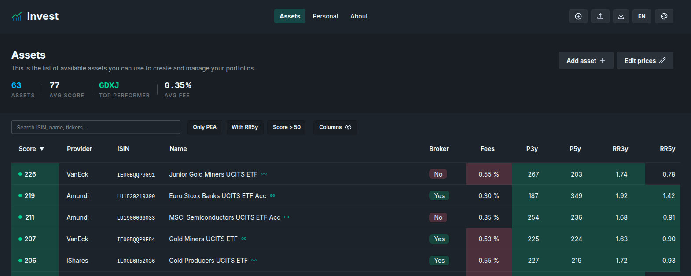

# invest

[](https://github.com/Shuunen/invest/blob/master/LICENSE)
[](https://hits.sh/github.com/Shuunen/invest/)



> Portfolio Tracker PWA — offline-first, local-persistence investment portfolio manager.

## Stack

- **React 19 + TypeScript** via Vite
- **TanStack Router** — type-safe routing
- **Zustand** — runtime state
- **Dexie.js** — IndexedDB persistence
- **Zod** — schema validation + import safety
- **TailwindCSS + DaisyUI** — styling
- **Vitest** — unit/integration tests
- **Playwright** — E2E tests (including offline/PWA)
- **vite-plugin-pwa** — PWA support
- **Turborepo** — task caching and parallel build orchestration

## Demo



## Dev

```bash
pnpm install
pnpm dev
```

## Test

```bash
pnpm test          # Vitest unit tests
pnpm test:e2e      # Playwright E2E
pnpm check         # Full pipeline: types, format, lint, build, tests, E2E
```

## Build

```bash
pnpm build
pnpm preview
```

## Data

Sample data lives in `data/sample.json`. Import it via the app's import function.

## Thanks

- [Boxy Svg](https://boxy-svg.com) : simple & effective svg editor
- [Bun](https://bun.sh) : super fast runtime for JavaScript and TypeScript
- [Github](https://github.com) : for all their great work year after year, pushing OSS forward
- [Knip](https://github.com/webpro/knip) : super tool to find & fix problems
- [Oxc](https://oxc.rs) : a lovely super-fast collection of JavaScript tools written in Rust
- [React](https://react.dev) : great library for web and native user interfaces
- [Shields.io](https://shields.io) : for the nice badges on top of this readme
- [Shuutils](https://github.com/Shuunen/shuutils) : collection of pure JS utils
- [Svg Omg](https://jakearchibald.github.io/svgomg/) : the great king of svg file size reduction
- [TailwindCss](https://tailwindcss.com) : awesome lib to produce maintainable style
- [V8](https://github.com/demurgos/v8-coverage) : simple & effective cli for code coverage
- [Vite](https://github.com/vitejs/vite) : super fast frontend tooling
- [Vitest](https://github.com/vitest-dev/vitest) : super fast vite-native testing framework
- [Zod](https://github.com/colinhacks/zod) : typeScript-first schema validation
